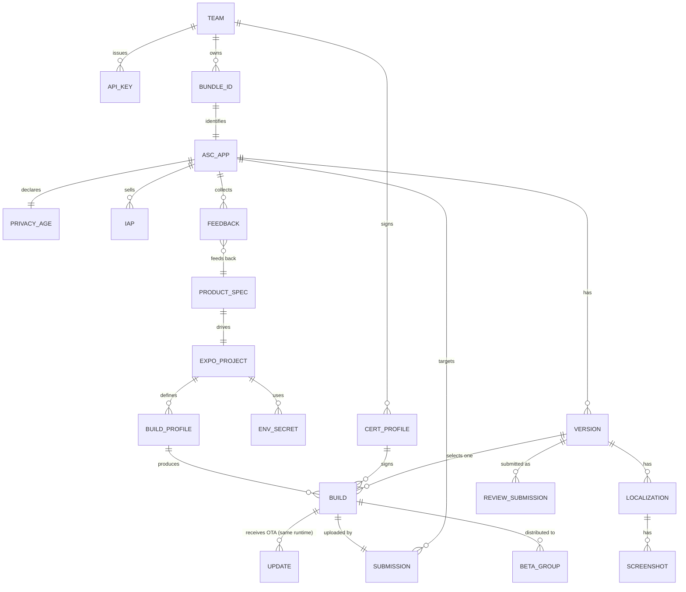

1. 主体类型：[[个体工商户]]
2. [[经营范围]]：经营范围如果是自己开发产品就可以写软件开发作为主营
3. 可以做
	1. 发布产品、备案
	2. 发布[[小鹅通]]付费课程
4. [[阿里云服务器]]

[[支付]]

[[App Store Connect CLI]]

> [!Info]
> 前一百个付费用户
> 1. 推行快速迭代、
> 2. 基于数据制定决策，
> 3. 以及早期顾客介入
> 


[[挑战一年五十个 AI 产品$]]

[[市场]]


[[Fastlane]]


| 阶段      | 产出                  | 工具链                                                                 | AI 能做到什么程度   |
| ------- | ------------------- | ------------------------------------------------------------------- | ------------ |
| 想法/定位   | 一页 PRD、目标用户、竞品、变现方式 | LLM + App Store 竞品调研                                                | 80%，人来定方向    |
| 设计      | 页面流程、品牌、图标          | Figma / 生图模型                                                        | 70%          |
| 开发      | Expo 应用             | Expo Router、NativeWind、Expo SDK                                     | 90%          |
| 后端/基础设施 | 登录、数据、支付            | Supabase/Firebase、RevenueCat、Sentry、PostHog                         | 80%          |
| 构建      | `.ipa` / `.aab`     | EAS Build（`eas build -p ios`）                                       | 95%（云端签名）    |
| 内测      | TestFlight 安装包      | EAS Submit / `npx testflight`                                       | 95%          |
| 商店素材    | 截图、文案、关键词、隐私标签      | Maestro 自动截图 + fastlane `frameit`、EAS Metadata（`store.config.json`） | 85%          |
| 提审/上架   | 发布到 App Store       | asc CLI / fastlane `deliver`、App Store Connect API                  | 70%，审核被拒要人判断 |
| 迭代      | 热更新、版本节奏            | EAS Update（JS 层 OTA）、EAS Workflows（CI）                              | 90%          |


| 1                  |                                                                |                                |     |
| ------------------ | -------------------------------------------------------------- | ------------------------------ | --- |
|                    | [[产品原则]]                                                   |                                |     |
| 插件设计           | [[插件设计]]                                                   |                                |     |
| 网站设计的最佳实践 | [[网站设计规范 - AI 参考文档]]                                 |                                |     |
|                    | [[AI 编程的中期陷阱]]                                          |                                |     |
| 登录最佳实践       | https://hf7l9aiqzx.feishu.cn/wiki/UO0Dw2qu5ij1wMk29jvcXJPonPe  |                                |     |
| 头像               | https://www.dicebear.com/playground/ 的                        |                                |     |
| 支付               | [[爱发电]]、小红书或者闲鱼的网店卖点卡充值、[[小红书自动发货]] | [[stripe]]                     |     |
| [[预约系统]]       | [[Calendly]]                                                   |                                |     |
| 推特[[抓取能力]]   | https://twitterapi.io/                                         |                                |     |
| 宣传视频           | [[宣传视频制作]]                                               | 微软Azure"云希"（Yunxi）的语音 |     |
|                    | [[指纹浏览器]]                                                 |                                |     |
|                    | [[AI 矩阵运营]]                                                |                                |     |
|                    | [[marketing]]                                                  |                                |     |
| 发布               | [[IOS开发]]<br>[[Obsidian插件发布]]                            |                                |     |
|                    |                                                                |                                |     |

[[为什么你的 AI 生成的网站看起来总是「差点意思」？]]
https://github.com/huifer/Claude-Ally-Health
- Flowee（项目管理应用，由
    
    @stanlee0nX
    
    构建）  
    一个完整的项目管理工具，支持任务规划、执行和协作（v2 计划添加实时协作）。用 Supabase 处理数据库和认证，结合 React + Shadcn UI 快速上线：[https://flowee-stanlee.vercel.app/](https://flowee-stanlee.vercel.app/)
- NoteAhead（AI 笔记应用，由
    
    @ryanlohyr
    
    构建）  
    智能笔记 App，能“提前预测”你的想法并自动补全。黑客松 24 小时内完成，使用 Supabase 存储 + Groq AI 集成实时功能。
- Habit Squad（习惯追踪 App，由
    
    @Zak_Aden_
    
    构建）  
    支持“责任伙伴”功能：错过习惯时自动发短信提醒朋友。用 Supabase 数据库 + Twilio 集成，实现实时通知和用户数据管理。
- Study Buddy（语言学习 tutor，由 Supabase 工程师构建）  
    AI 驱动的闪卡应用，支持创建卡组、翻卡和进度追踪。结合 Supabase Realtime 和 Alpic AI，实现互动学习体验：[https://study-buddy.alpic.live/](https://study-buddy.alpic.live/)
- 儿童故事书 App（黑客松项目，由
    
    @AparnaSoneja
    
    构建）  
    个性化儿童故事生成器，支持生成 PDF 并邮件发送。用 Supabase 处理用户数据 + OpenAI 生成内容，促进阅读习惯。
vue3 setup+ts+pinia+vue-router+axios，移动端 vant，

管理后台 ant-design，arco-design，[Element Plus](Element%20Plus.md) 之类选顺眼的，

[Vue3@](Vue3@.md) 基本都是标配，没啥需要选的、

Novel is a Notion-style WYSIWYG editor with AI-powered autocompletion. Built with Tiptap + Vercel AI SDK.


> 所以我还是去坚持我的看法，对独立开发产品而言，一定要敢于不提供免费试用（至少一开始不提供，什么时候提供后面细说）哪怕定个1元的价格，也一定要收费。这会帮我们很大程度上排除一些前期具有误导性的尝鲜客户，他们很可能带来不了价值甚至会提出一些让你产品迭代跑偏的一些建议。


[[stripe]]


你的核心观点是：
- **独立开发**是好的，但对程序员而言，**持续找工作**才是最稳妥的路径。
- 找到合适的工作，本质上是一种**结构耦合**和**市场验证**：能找到说明你的结构能被市场调用，找不到说明你结构老化或叙事脱节。
- 在美国环境下，加入**VC支持的公司**是最具杠杆效应的路径（现金流+股权+试错+人脉）。
- **就业的最大优势**是即时现金流，同时它也是一种验证/学习/探索体系。
- 独立开发并不是真正的“独立”，仍然依赖平台、分发、支付/法律，更多是一种心理身份标签。
- 最终“超级个体”≠“孤胆英雄”，仍需回到组织中，如果没有合适组织，就需要自己创立一个。
    
潜在隐性假设：
1. **工作机会是最主要的市场验证机制**（忽略了其他形式的市场反馈，如创业产品的收入、用户增长）
2. **VC支持的公司优于独立开发**（可能忽视了独立开发的某些灵活性、规模效应或文化因素）。
3. **“组织”是唯一可持续的归宿**（默认了个体必须最终依附于某种组织形态）。
    


好的！根据您提供的 X 帖子（[https://x.com/axichuhai/status/1907302109109997975）及其后续回复，帖子详细描述了](https://x.com/axichuhai/status/1907302109109997975%EF%BC%89%E5%8F%8A%E5%85%B6%E5%90%8E%E7%BB%AD%E5%9B%9E%E5%A4%8D%EF%BC%8C%E5%B8%96%E5%AD%90%E8%AF%A6%E7%BB%86%E6%8F%8F%E8%BF%B0%E4%BA%86) PrajwalTomar 如何使用工具（UX Pilot、Lovable、Supabase 和 Cursor）设计和开发一个名为 MoodFlow 的 AI 日记应用的过程。我会将这个过程整理成一个 Markdown 表格，清晰展示每个步骤及其描述。

以下是整理后的表格：

| 步骤                   | 描述                                                                                              |
| -------------------- | ----------------------------------------------------------------------------------------------- |
| 1. 从一个清晰的想法开始        | 在使用任何工具之前，先明确核心问题、解决方案和目标用户，为整个开发过程奠定基础。案例为一个名为 MoodFlow 的 AI 日记应用。                             |
| 2. 深入挖掘产品愿景          | 明确 MVP（最小可行产品），拆解用户使用路径，找准关键痛点，规划应用如何解决问题，以节省后续开发时间并确保流程顺畅。                                     |
| 3. 选择 PWA 而非原生应用     | 决定将应用做成 PWA（渐进式网页应用），原因包括：一个代码库适配手机和桌面、不受应用商店审核限制、测试和迭代更方便，适合早期产品快速上线。                          |
| 4. 优先聚焦核心功能          | 精简 MVP 功能，控制在 5 个主要功能以内，包括用户认证、Stripe 支付（若需要）和核心用户流程，范围越小上线越快。                                  |
| 5. 起草 UI 开发计划        | 使用 ChatGPT 列出 PWA 所需的所有页面及其详细描述，形成 UI 蓝图，并可转化为网站地图展示给客户以快速审核。                                   |
| 6. 在 UX Pilot 中生成 UI | 将页面描述输入 UX Pilot，几秒内生成干净、高保真的 UI 界面，可调整字体和结构，导出代码或截图以备开发。                                       |
| 7. 在 Lovable 里组装一切   | 在 Lovable 中上传项目简介和 UX Pilot 导出的代码，规划导航和逻辑，连接前端状态和交互，几小时内完成一个功能完整的 PWA。                          |
| 8. 通过 Supabase 搞定后端  | 利用 Lovable 对 Supabase 的支持，处理用户认证（邮箱+魔法链接）、数据库（日记、心情、反思）、AI 逻辑的边缘函数和语音笔记的安全存储，无需操心 DevOps 或复杂配置。 |
| 9. 处理复杂逻辑（使用 Cursor） | 虽然本次开发未使用，但 Cursor 可用于 AI 编辑数据库结构、生成迁移文件、添加行级安全策略（RLS）以及优化查询。                                   |
| 10. 发布和部署            | 在 Lovable 中预览，通过 Netlify 绑定自定义域名，添加 PWA 清单，使其可像原生应用一样安装，完成上线，用户即可使用。                            |

补充说明

- 工具使用：整个过程依赖于 UX Pilot（生成 UI）、Lovable（组装前后端）、Supabase（后端支持）和 Cursor（复杂逻辑处理，视需求使用）。
    
- 效率：通过这些工具，PrajwalTomar 避免了传统设计工具（如 Figma）、大型设计团队和长时间的开发周期，快速完成了 MoodFlow 的 MVP 开发。
    
- MoodFlow：根据相关网页信息，MoodFlow 是一个专注于心情追踪和日记的应用，注重用户体验（干净 UI、自定义性、无干扰广告等）。
    

如果您需要更详细的分析或对某一步骤有进一步疑问，请告诉我！

与 [软件工程@](软件工程@.md) 不同，独立开发包括下面


# Vibe Product 流程中最重要的 20 个对象

按“身份 → 代码 → 构建 → 分发 → 商店 → 运营”分为六层，序号大致代表重要程度。

## A. 身份与权限（地基）

| # | 对象 | 关键字段 | 说明 |
|---|---|---|---|
| 1 | **Apple Developer Team** | Team ID、账号类型（个人/公司） | 所有 Apple 资源的归属方 |
| 2 | **App Store Connect API Key** | Key ID、Issuer ID、`.p8` | CLI 和 Agent 自动化的通行证 |
| 3 | **Bundle ID（App ID）** | `com.xxx.app`、Capabilities（推送、Apple 登录、IAP） | App 的全局唯一身份，**一旦上架不能改** |
| 4 | **Certificate + Provisioning Profile** | 发布证书、描述文件 | 签名凭证，建议交给 EAS 托管 |

## B. 代码与项目

| # | 对象 | 关键字段 | 说明 |
|---|---|---|---|
| 5 | **Product Spec（PRD）** | 目标用户、核心功能、变现方式、范围外功能 | Vibe product 的“源头对象”，驱动后面所有决策 |
| 6 | **Expo Project** | `app.json`/`app.config.ts`、slug、`projectId`、owner | 代码与配置的根 |
| 7 | **Environment / Secrets** | EAS env（development / preview / production） | API 密钥、后端地址等，按环境区分 |

## C. 构建与版本

| #   | 对象                           | 关键字段                                             | 说明                                  |
| --- | ---------------------------- | ------------------------------------------------ | ----------------------------------- |
| 8   | **Build Profile**            | `eas.json` 中的 development / preview / production | 决定怎么构建、给谁用                          |
| 9   | **Build** ✅                  | `.ipa`、buildNumber、状态、commit                     | 一次具体的构建产物                           |
| 10  | **Version**                  | 营销版本号（如 `1.2.0`），对应 App Store Version            | 用户看到的版本，一个 Version 可以包含多个 Build     |
| 11  | **Runtime Version + Update** | runtimeVersion、Channel、Branch                    | EAS OTA 热更新；只有 runtime 一致的安装包才能收到更新 |

## D. 分发与提审

| # | 对象 | 关键字段 | 说明 |
|---|---|---|---|
| 12 | **Submission** | EAS Submit 记录，Build 对应到 ASC | 把构建产物传到 Apple |
| 13 | **TestFlight Beta Group / Tester** | 内部组 / 外部组、测试说明 | 内测分发；外部测试也需要过 Beta 审核 |
| 14 | **Review Submission** | 审核状态、拒审原因、审核信息（演示账号、备注） | 提审与被拒、申诉的闭环 |

## E. 商店展示

| # | 对象 | 关键字段 | 说明 |
|---|---|---|---|
| 15 | **App 记录（ASC App）** | Apple ID、SKU、主语言、Bundle ID | 商店里的那个 App 本身 |
| 16 | **Store Listing / Localization** | 名称、副标题、描述、关键词、宣传文本、支持 URL | ASO 的核心，可放进 `store.config.json` 管理 |
| 17 | **Screenshots / App Previews** | 按设备尺寸分组（6.9"、iPad 13"） | 决定转化率，可以自动生成 |
| 18 | **App Privacy + Age Rating** | 隐私标签、隐私政策 URL、年龄分级问卷 | 合规必填项，必须和实际接入的 SDK 一致 |

## F. 商业化与运营

| # | 对象 | 关键字段 | 说明 |
|---|---|---|---|
| 19 | **IAP / Subscription** | Product ID、订阅组、价格档位、Entitlement（RevenueCat） | 收入来源 |
| 20 | **Feedback Signals** | 崩溃（Sentry）、事件埋点（PostHog）、用户评分与评论、TestFlight 反馈 | 驱动下一轮迭代，回流到 PRD |

## 对象关系图



## 三个最容易搞混的地方

- **Version 与 Build Number**：`1.2.0` 是给用户看的版本号；buildNumber 每次构建都必须递增。可以在 EAS 里开启 `autoIncrement` 自动处理。
- **Build 与 Update**：改了原生代码或权限就要重新 Build 并提审；只改 JS 和资源可以走 Update，不用过审。
- **Bundle ID、App 记录、Expo Project 是三个不同的对象**：分别属于 Apple 开发者后台、App Store Connect 和 Expo，靠 Bundle ID 串起来。

如果要做成 Skill 或插件，可以把这 20 个对象设计成**状态机**，例如 Build：`queued → built → submitted → processing → testflight → selected_for_version → in_review → live`。Agent 根据每个对象当前的状态，判断下一步该执行哪条命令。需要的话我可以继续把这个状态机细化出来。


```Java

<span class="RichText ztext CopyrightRichText-richText css-1ygg4xu" options="[object Object]" itemprop="text"><p data-first-child="" data-pid="J7vPRruD">我是全栈，所有主流后端开发语言我都做过项目，所有前端我都上线过项目。</p><p data-pid="OUm4OOe0">据我实践，最最简单的技术站栈是：Android 和 iOS 用 uniapp，桌面端用 electron（跨平台），`后端用<span>`<a class="RichContent-EntityWord css-b7erz1" data-za-not-track-link="true" data-paste-text="true" href="https://www.zhihu.com/search?q=Nodejs&amp;search_source=Entity&amp;hybrid_search_source=Entity&amp;hybrid_search_extra=%7B%22sourceType%22%3A%22answer%22%2C%22sourceId%22%3A3383558689%7D" target="_blank">Nodejs<svg width="10px" height="10px" viewBox="0 0 15 15" class="css-1dvsrp"><path d="M10.89 9.477l3.06 3.059a1 1 0 0 1-1.414 1.414l-3.06-3.06a6 6 0 1 1 1.414-1.414zM6 10a4 4 0 1 0 0-8 4 4 0 0 0 0 8z" fill="currentColor"></path></svg></a></span>，数据库 mysql。看看，这个技术栈仅仅围绕着 javascript 语言，你要是勤奋点，`学会<span>`<a class="RichContent-EntityWord css-b7erz1" data-za-not-track-link="true" data-paste-text="true" href="https://www.zhihu.com/search?q=typescript&amp;search_source=Entity&amp;hybrid_search_source=Entity&amp;hybrid_search_extra=%7B%22sourceType%22%3A%22answer%22%2C%22sourceId%22%3A3383558689%7D" target="_blank">typescript<svg width="10px" height="10px" viewBox="0 0 15 15" class="css-1dvsrp"><path d="M10.89 9.477l3.06 3.059a1 1 0 0 1-1.414 1.414l-3.06-3.06a6 6 0 1 1 1.414-1.414zM6 10a4 4 0 1 0 0-8 4 4 0 0 0 0 8z" fill="currentColor"></path></svg></a></span>就更牛了。</p><p class="ztext-empty-paragraph"><br></p><p data-pid="rF3Y5JlX">作为一个独立开发者，就不用考虑 kpi 等，原则只有一个：哪个效率最好。以此，`我认为合理的<span>`<a class="RichContent-EntityWord css-b7erz1" data-za-not-track-link="true" data-paste-text="true" href="https://www.zhihu.com/search?q=%E6%8A%80%E6%9C%AF%E6%A0%88&amp;search_source=Entity&amp;hybrid_search_source=Entity&amp;hybrid_search_extra=%7B%22sourceType%22%3A%22answer%22%2C%22sourceId%22%3A3383558689%7D" target="_blank">技术栈<svg width="10px" height="10px" viewBox="0 0 15 15" class="css-1dvsrp"><path d="M10.89 9.477l3.06 3.059a1 1 0 0 1-1.414 1.414l-3.06-3.06a6 6 0 1 1 1.414-1.414zM6 10a4 4 0 1 0 0-8 4 4 0 0 0 0 8z" fill="currentColor"></path></svg></a></span>：</p><p data-pid="Z0s3dGKh">后端：java `的<span>`<a class="RichContent-EntityWord css-b7erz1" data-za-not-track-link="true" data-paste-text="true" href="https://www.zhihu.com/search?q=springboot&amp;search_source=Entity&amp;hybrid_search_source=Entity&amp;hybrid_search_extra=%7B%22sourceType%22%3A%22answer%22%2C%22sourceId%22%3A3383558689%7D" target="_blank">springboot<svg width="10px" height="10px" viewBox="0 0 15 15" class="css-1dvsrp"><path d="M10.89 9.477l3.06 3.059a1 1 0 0 1-1.414 1.414l-3.06-3.06a6 6 0 1 1 1.414-1.414zM6 10a4 4 0 1 0 0-8 4 4 0 0 0 0 8z" fill="currentColor"></path></svg></a></span>+mysql+redis+<span><a class="RichContent-EntityWord css-b7erz1" data-za-not-track-link="true" data-paste-text="true" href="https://www.zhihu.com/search?q=nginx&amp;search_source=Entity&amp;hybrid_search_source=Entity&amp;hybrid_search_extra=%7B%22sourceType%22%3A%22answer%22%2C%22sourceId%22%3A3383558689%7D" target="_blank">nginx<svg width="10px" height="10px" viewBox="0 0 15 15" class="css-1dvsrp"><path d="M10.89 9.477l3.06 3.059a1 1 0 0 1-1.414 1.414l-3.06-3.06a6 6 0 1 1 1.414-1.414zM6 10a4 4 0 1 0 0-8 4 4 0 0 0 0 8z" fill="currentColor"></path></svg></a></span>。</p><p data-pid="fy7RCsEU">java 强类型语言，ide 就能帮你解决掉 99% 的问题；你调用的第 3 方接口，`如果有<span>`<a class="RichContent-EntityWord css-b7erz1" data-za-not-track-link="true" data-paste-text="true" href="https://www.zhihu.com/search?q=sdk&amp;search_source=Entity&amp;hybrid_search_source=Entity&amp;hybrid_search_extra=%7B%22sourceType%22%3A%22answer%22%2C%22sourceId%22%3A3383558689%7D" target="_blank">sdk<svg width="10px" height="10px" viewBox="0 0 15 15" class="css-1dvsrp"><path d="M10.89 9.477l3.06 3.059a1 1 0 0 1-1.414 1.414l-3.06-3.06a6 6 0 1 1 1.414-1.414zM6 10a4 4 0 1 0 0-8 4 4 0 0 0 0 8z" fill="currentColor"></path></svg></a></span>肯定都先支持 java；车轮子没有比 java 更多的了。spring 系列很强大，你遇到的问题，这套工具都能帮你解决。</p><p class="ztext-empty-paragraph"><br></p><p data-pid="tktYUjy5">网页：<span><a class="RichContent-EntityWord css-b7erz1" data-za-not-track-link="true" data-paste-text="true" href="https://www.zhihu.com/search?q=vue&amp;search_source=Entity&amp;hybrid_search_source=Entity&amp;hybrid_search_extra=%7B%22sourceType%22%3A%22answer%22%2C%22sourceId%22%3A3383558689%7D" target="_blank">vue<svg width="10px" height="10px" viewBox="0 0 15 15" class="css-1dvsrp"><path d="M10.89 9.477l3.06 3.059a1 1 0 0 1-1.414 1.414l-3.06-3.06a6 6 0 1 1 1.414-1.414zM6 10a4 4 0 1 0 0-8 4 4 0 0 0 0 8z" fill="currentColor"></path></svg></a></span>，简单易学，这玩意就是比另外两个简单容易上手。再个，你找的别人任意 html 代码，都能很容易地集成到你的项目中。</p><p class="ztext-empty-paragraph"><br></p><p data-pid="eHgu1ZUw">网页 UI 库：这个你随意，精通一个就好，`我用的最熟练的就是<span>`<a class="RichContent-EntityWord css-b7erz1" data-za-not-track-link="true" data-paste-text="true" href="https://www.zhihu.com/search?q=elementui&amp;search_source=Entity&amp;hybrid_search_source=Entity&amp;hybrid_search_extra=%7B%22sourceType%22%3A%22answer%22%2C%22sourceId%22%3A3383558689%7D" target="_blank">elementui<svg width="10px" height="10px" viewBox="0 0 15 15" class="css-1dvsrp"><path d="M10.89 9.477l3.06 3.059a1 1 0 0 1-1.414 1.414l-3.06-3.06a6 6 0 1 1 1.414-1.414zM6 10a4 4 0 1 0 0-8 4 4 0 0 0 0 8z" fill="currentColor"></path></svg></a></span></p><p class="ztext-empty-paragraph"><br></p><p data-pid="SKMv-8JT">android 和 ios 用：<span><a class="RichContent-EntityWord css-b7erz1" data-za-not-track-link="true" data-paste-text="true" href="https://www.zhihu.com/search?q=uniapp&amp;search_source=Entity&amp;hybrid_search_source=Entity&amp;hybrid_search_extra=%7B%22sourceType%22%3A%22answer%22%2C%22sourceId%22%3A3383558689%7D" target="_blank">uniapp<svg width="10px" height="10px" viewBox="0 0 15 15" class="css-1dvsrp"><path d="M10.89 9.477l3.06 3.059a1 1 0 0 1-1.414 1.414l-3.06-3.06a6 6 0 1 1 1.414-1.414zM6 10a4 4 0 1 0 0-8 4 4 0 0 0 0 8z" fill="currentColor"></path></svg></a></span>，原生和网页结合，没有解决不了的问题。还可以复用那么多网页开发的轮子。</p><p class="ztext-empty-paragraph"><br></p><p data-pid="zRjEcPNl">桌面端：如果你的软件仅仅针对 windows，C#`的<span>`<a class="RichContent-EntityWord css-b7erz1" data-za-not-track-link="true" data-paste-text="true" href="https://www.zhihu.com/search?q=winform&amp;search_source=Entity&amp;hybrid_search_source=Entity&amp;hybrid_search_extra=%7B%22sourceType%22%3A%22answer%22%2C%22sourceId%22%3A3383558689%7D" target="_blank">winform<svg width="10px" height="10px" viewBox="0 0 15 15" class="css-1dvsrp"><path d="M10.89 9.477l3.06 3.059a1 1 0 0 1-1.414 1.414l-3.06-3.06a6 6 0 1 1 1.414-1.414zM6 10a4 4 0 1 0 0-8 4 4 0 0 0 0 8z" fill="currentColor"></path></svg></a></span>和 wpf 那就是神一样的存在。如果要跨平台，不用想，<span><a class="RichContent-EntityWord css-b7erz1" data-za-not-track-link="true" data-paste-text="true" href="https://www.zhihu.com/search?q=electron&amp;search_source=Entity&amp;hybrid_search_source=Entity&amp;hybrid_search_extra=%7B%22sourceType%22%3A%22answer%22%2C%22sourceId%22%3A3383558689%7D" target="_blank">electron<svg width="10px" height="10px" viewBox="0 0 15 15" class="css-1dvsrp"><path d="M10.89 9.477l3.06 3.059a1 1 0 0 1-1.414 1.414l-3.06-3.06a6 6 0 1 1 1.414-1.414zM6 10a4 4 0 1 0 0-8 4 4 0 0 0 0 8z" fill="currentColor"></path></svg></a></span>那绝对是不二之选。至于 qt，如果你很熟悉，你就选。你不熟悉，那 electron 就是最好的。</p><hr><p data-pid="wBQ8LWPH">看到有人收藏了，那我给你们说说。</p><p data-pid="QdUlVgd2">其实，独立开发者的第一技能就是要勤奋好学。</p><p data-pid="CVNJelyh">对于安卓和 iOS 开发，你得会原生开发，你可以说你不熟练，但是你不能不会。最起码，耐着性子，把教程看完，把 demo 运行起来。</p><p data-pid="PH_M0BZE">对于，桌面端开发，同上。</p><p data-pid="Ns2rxHSb">对于后端，Python 写脚本，<span><a class="RichContent-EntityWord css-b7erz1" data-za-not-track-link="true" data-paste-text="true" href="https://www.zhihu.com/search?q=nodejs&amp;search_source=Entity&amp;hybrid_search_source=Entity&amp;hybrid_search_extra=%7B%22sourceType%22%3A%22answer%22%2C%22sourceId%22%3A3383558689%7D" target="_blank">nodejs<svg width="10px" height="10px" viewBox="0 0 15 15" class="css-1dvsrp"><path d="M10.89 9.477l3.06 3.059a1 1 0 0 1-1.414 1.414l-3.06-3.06a6 6 0 1 1 1.414-1.414zM6 10a4 4 0 1 0 0-8 4 4 0 0 0 0 8z" fill="currentColor"></path></svg></a></span>开发个静态网页、网络代理代理，<span><a class="RichContent-EntityWord css-b7erz1" data-za-not-track-link="true" data-paste-text="true" href="https://www.zhihu.com/search?q=php&amp;search_source=Entity&amp;hybrid_search_source=Entity&amp;hybrid_search_extra=%7B%22sourceType%22%3A%22answer%22%2C%22sourceId%22%3A3383558689%7D" target="_blank">php<svg width="10px" height="10px" viewBox="0 0 15 15" class="css-1dvsrp"><path d="M10.89 9.477l3.06 3.059a1 1 0 0 1-1.414 1.414l-3.06-3.06a6 6 0 1 1 1.414-1.414zM6 10a4 4 0 1 0 0-8 4 4 0 0 0 0 8z" fill="currentColor"></path></svg></a></span>搭建个博客，你都学一学。为啥了？因为你真的要在网络上找资源时，什么需要开发的都有。</p><p data-pid="1YcjRf92">学习么，不要求你两三天就充分掌握一门技能。你今天看一看，过段时间再看一看，你就慢慢掌握了。开发语言是相同的，你会学的越来越快 </p><hr><p data-pid="dulfn6U6">我就是独立开发者，给大家说说我用到的技术吧。</p><p data-pid="dhHCisP2">Java 的 springboot 是后端，<span><a class="RichContent-EntityWord css-b7erz1" data-za-not-track-link="true" data-paste-text="true" href="https://www.zhihu.com/search?q=MySQL%E6%95%B0%E6%8D%AE%E5%BA%93&amp;search_source=Entity&amp;hybrid_search_source=Entity&amp;hybrid_search_extra=%7B%22sourceType%22%3A%22answer%22%2C%22sourceId%22%3A3383558689%7D" target="_blank">MySQL 数据库<svg width="10px" height="10px" viewBox="0 0 15 15" class="css-1dvsrp"><path d="M10.89 9.477l3.06 3.059a1 1 0 0 1-1.414 1.414l-3.06-3.06a6 6 0 1 1 1.414-1.414zM6 10a4 4 0 1 0 0-8 4 4 0 0 0 0 8z" fill="currentColor"></path></svg></a></span>，能不用缓存就不用缓存。</p><p data-pid="wkYxWzbJ">C#的 wpf 开发桌面端。`如今也<span>`<a class="RichContent-EntityWord css-b7erz1" data-za-not-track-link="true" data-paste-text="true" href="https://www.zhihu.com/search?q=Electron&amp;search_source=Entity&amp;hybrid_search_source=Entity&amp;hybrid_search_extra=%7B%22sourceType%22%3A%22answer%22%2C%22sourceId%22%3A3383558689%7D" target="_blank">Electron<svg width="10px" height="10px" viewBox="0 0 15 15" class="css-1dvsrp"><path d="M10.89 9.477l3.06 3.059a1 1 0 0 1-1.414 1.414l-3.06-3.06a6 6 0 1 1 1.414-1.414zM6 10a4 4 0 1 0 0-8 4 4 0 0 0 0 8z" fill="currentColor"></path></svg></a></span>+vue2 开发桌面端。typescript 在用，这玩意的类型真好使。</p><p data-pid="TIUV-VeR">nodejs 用来开发各种模板，很好使，再个 electron 必然会用。</p><p data-pid="LCJMttEN">移动端，用的是 uniapp。</p><p data-pid="O-kzpC3i"><span><a class="RichContent-EntityWord css-b7erz1" data-za-not-track-link="true" data-paste-text="true" href="https://www.zhihu.com/search?q=Delphi&amp;search_source=Entity&amp;hybrid_search_source=Entity&amp;hybrid_search_extra=%7B%22sourceType%22%3A%22answer%22%2C%22sourceId%22%3A3383558689%7D" target="_blank">Delphi<svg width="10px" height="10px" viewBox="0 0 15 15" class="css-1dvsrp"><path d="M10.89 9.477l3.06 3.059a1 1 0 0 1-1.414 1.414l-3.06-3.06a6 6 0 1 1 1.414-1.414zM6 10a4 4 0 1 0 0-8 4 4 0 0 0 0 8z" fill="currentColor"></path></svg></a></span>也会用一点，主要用来开发安装包工具。</p><p data-pid="UhSqbJzg">其他的偶尔用，比如 php 主要是搭建个博客，官网啥的。<span><a class="RichContent-EntityWord css-b7erz1" data-za-not-track-link="true" data-paste-text="true" href="https://www.zhihu.com/search?q=golang&amp;search_source=Entity&amp;hybrid_search_source=Entity&amp;hybrid_search_extra=%7B%22sourceType%22%3A%22answer%22%2C%22sourceId%22%3A3383558689%7D" target="_blank">golang<svg width="10px" height="10px" viewBox="0 0 15 15" class="css-1dvsrp"><path d="M10.89 9.477l3.06 3.059a1 1 0 0 1-1.414 1.414l-3.06-3.06a6 6 0 1 1 1.414-1.414zM6 10a4 4 0 1 0 0-8 4 4 0 0 0 0 8z" fill="currentColor"></path></svg></a></span>也是偶尔开发个代理或者简单的 http 服务器。Python 除非是网上的开源工具用到了，否则我不用，感觉代码比较难维护。</p><p data-pid="REfkgW4R">`像<span>`<a class="RichContent-EntityWord css-b7erz1" data-za-not-track-link="true" data-paste-text="true" href="https://www.zhihu.com/search?q=flutter&amp;search_source=Entity&amp;hybrid_search_source=Entity&amp;hybrid_search_extra=%7B%22sourceType%22%3A%22answer%22%2C%22sourceId%22%3A3383558689%7D" target="_blank">flutter<svg width="10px" height="10px" viewBox="0 0 15 15" class="css-1dvsrp"><path d="M10.89 9.477l3.06 3.059a1 1 0 0 1-1.414 1.414l-3.06-3.06a6 6 0 1 1 1.414-1.414zM6 10a4 4 0 1 0 0-8 4 4 0 0 0 0 8z" fill="currentColor"></path></svg></a></span>也学过，试了一下，那个嵌套让人头大。qt 了，老感觉要收费，还有编译太慢了，不怎么用。</p><p data-pid="imYOZJcP">其他的流行语言也学过，我感觉我用不上。</p><p data-pid="LGlot2YS">对于我来说，会网页开发，java 和 c#这两个万金油语言，几乎可以应对所有的开发情况了。</p><p></p><p></p></span>
```
